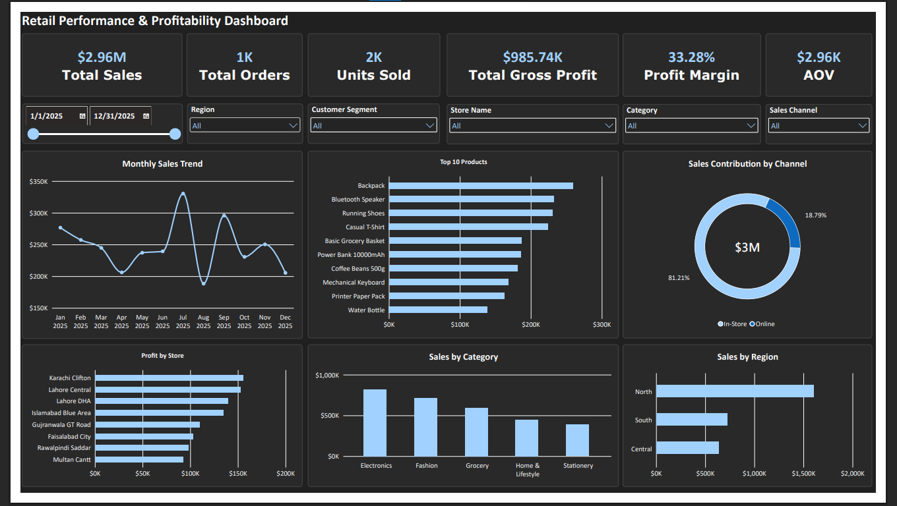
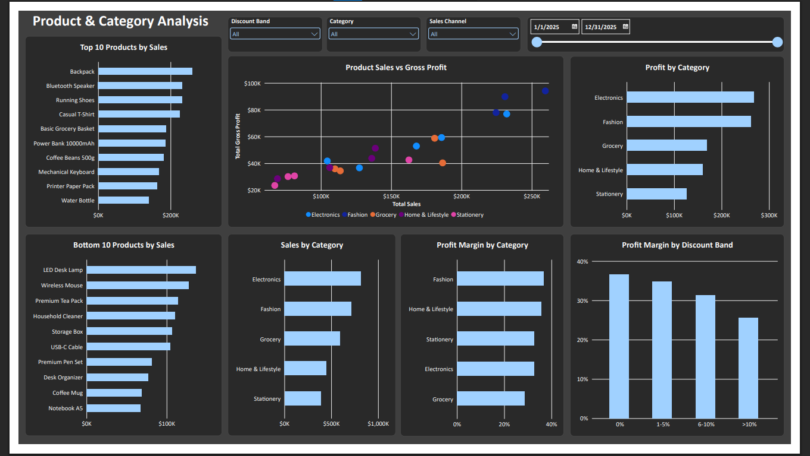
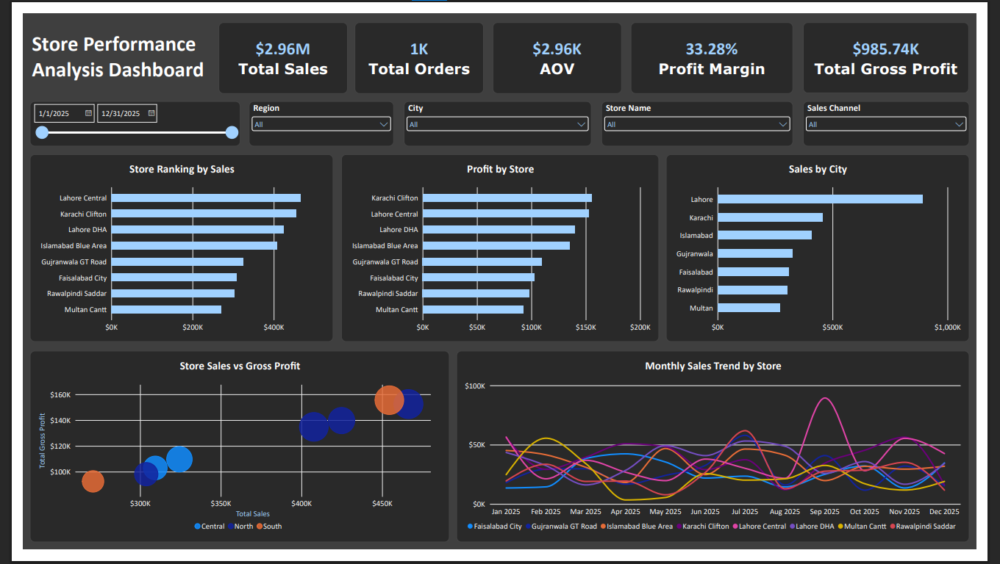

# Retail Store Performance & Profitability Analysis

An end-to-end retail analytics case study built with **Microsoft Excel** and **Power BI**. The project examines sales performance, gross profitability, product/category performance, discount patterns, customer segments, sales channels, stores, and cities.

> **Dataset notice:** This is a simulated portfolio project using 1,000 synthetic transaction records. It does not represent an actual retailer or real customers. Currency is displayed using `$` in the workbook/report for presentation purposes.

## Dashboard Preview

### 1. Executive Overview



### 2. Product & Category Analysis



### 3. Store Performance



## Business Objectives

- Measure overall sales, gross profit, gross margin, order volume, units sold, and average order value.
- Identify the categories and products generating the most sales and gross profit.
- Compare product margins and investigate low-margin or low-performing products.
- Assess the relationship between discount bands and gross profit margin.
- Compare Consumer and Business customers and In-Store versus Online performance.
- Rank stores and compare sales/profitability by store, city, region, and month.
- Translate the analysis into practical recommendations and follow-up questions.

## Tools & Skills

- **Microsoft Excel:** data familiarization, quality checks, formulas, PivotTables, grouped analysis, charting, and exploratory analysis.
- **Power BI Desktop:** data model, date table, relationships, DAX measures, slicers, interactive dashboards, bar/column charts, line charts, donut chart, and scatter plot.
- **DAX:** aggregation measures, profit margin, average order value, discount bands, and ranking/filter-context analysis.
- **Microsoft Word:** business findings, recommendations, methodology, KPI definitions, and limitations.

## Key KPIs

| KPI | Definition |
|---|---|
| Net Sales | Gross sales less discounts |
| Gross Profit | Net sales less cost of goods sold (COGS) |
| Gross Profit Margin | Total gross profit divided by total net sales |
| Orders | Distinct count of Order ID |
| Units Sold | Sum of Quantity |
| Average Order Value (AOV) | Total net sales divided by orders |
| Discount Rate | Total discount amount divided by gross sales |

## Selected Findings

These figures are based on the synthetic dataset and should be interpreted as findings from a practice case study, not claims about a real business.

- **Overall:** Net sales were approximately **$2.962M**, gross profit was approximately **$985.74K**, and gross profit margin was approximately **33.28%**.
- **Category performance:** Electronics generated the highest category sales (approximately **$817.75K**). Fashion showed the highest category gross margin (approximately **36.61%**).
- **Product follow-up:** Basic Grocery Basket generated approximately **$186.56K** in sales, with a gross margin of approximately **21.62%**. Its cost and discount profile merits further review before making any assortment decision.
- **Store performance:** Lahore Central had the highest store sales (approximately **$466.25K**), while Karachi Clifton generated the highest gross profit (approximately **$155.50K**). This illustrates why revenue and gross profit should be assessed separately.
- **Discounts:** Overall margin declined across the observed discount bands—from approximately **36.67%** for transactions with no discount to **25.64%** for transactions discounted above 10%. This is an association, not proof that discounts alone caused the lower margin.
- **Monthly trend:** July was the strongest month by sales (approximately **$330.35K**), while August was the weakest (approximately **$188.30K**). These months should be investigated for product mix, promotions, and other potential explanations.
- **Customer segments:** Consumer customers contributed more total sales because they accounted for more transactions; Business customers had a higher average order value in the dataset.
- **Sales channels:** In-Store sales were substantially higher than Online sales, while the two channels had similar gross profit margins in the initial analysis.

## Recommendations to Investigate

1. **Review high-discount transactions.** Compare margin by category, product, store, and channel before changing discount policy. Test targeted discounts against a baseline and monitor incremental sales and gross profit.
2. **Investigate low-margin products.** Review supplier cost, selling price, discount frequency, and product role for products with high sales but relatively weak margin. Do not discontinue an item based on sales alone.
3. **Compare store performance on multiple measures.** Review sales, gross profit, margin, order count, and AOV together. Investigate why sales and gross-profit leaders differ.
4. **Examine monthly outliers.** Compare the strongest and weakest months by category, channel, store, and discount band before attributing the pattern to seasonality or promotions.
5. **Develop the online channel based on evidence.** Compare product mix, AOV, margin, and order volume by channel before recommending additional investment.

Recommended next step for a real business would be to validate these hypotheses with operational data and run controlled tests before implementing changes.

## Repository Contents

```text
Retail-Store-Performance-Profitability/
├── README.md
├── data/
│   └── Retail_Store_Performance_1000_Records.xlsx
├── powerbi/
│   └── Retail_Store_Performance.pbix   # Add your saved PBIX file here
├── report/
│   └── Retail_Store_Performance_Findings_Recommendations_Report.docx
└── screenshots/
    ├── executive-overview.png
    ├── product-category-analysis.png
    └── store-performance.png
```

The starter package includes the dataset, written report, and dashboard screenshots. **Add your actual `.pbix` file to the `powerbi/` folder before publishing the repository**; it was not available in the materials used to create this starter package.

## How to Use

1. Download or clone this repository.
2. Open the Excel dataset in `data/` to inspect the source records and formulas.
3. Open `powerbi/Retail_Store_Performance.pbix` in Power BI Desktop after adding the file.
4. If the source workbook path differs from the path on your computer, update the data source in Power BI (for example, through **Transform data** / **Data source settings**) and refresh the model.
5. Review the Word report in `report/` for the findings, definitions, recommendations, and limitations.

## Limitations

- The dataset is synthetic and contains only 1,000 transaction records; findings are for demonstration and learning.
- Gross profit is not net profit: store operating costs such as rent, utilities, and salaries are not modeled.
- Observed relationships (such as discount band and margin) are descriptive and do not establish causation.
- Business recommendations should be validated against additional data before being applied in a real retail operation.

## Suggested GitHub Topics

`power-bi` · `data-analytics` · `excel` · `dax` · `retail-analytics` · `business-intelligence` · `data-visualization`
